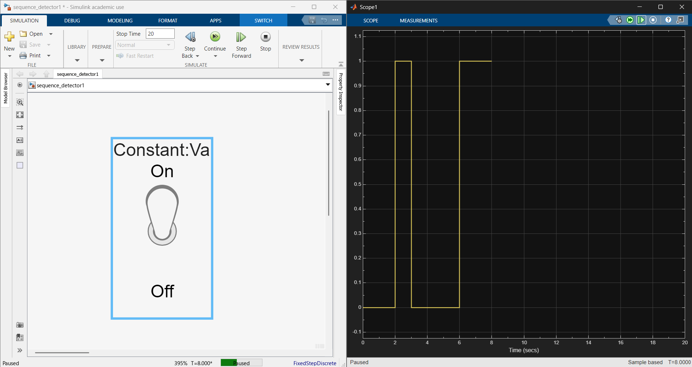
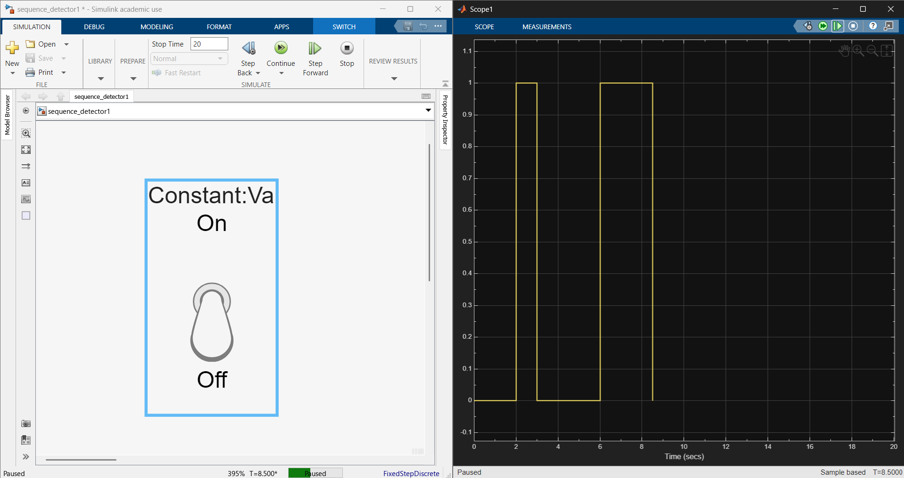
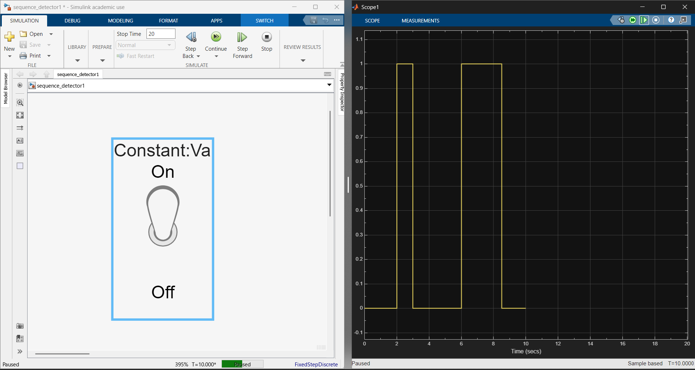
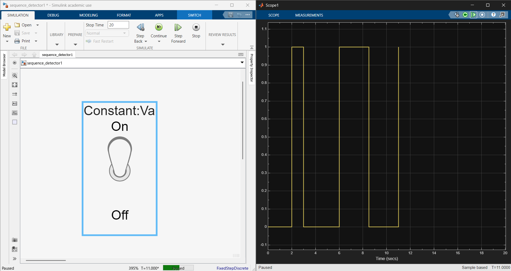
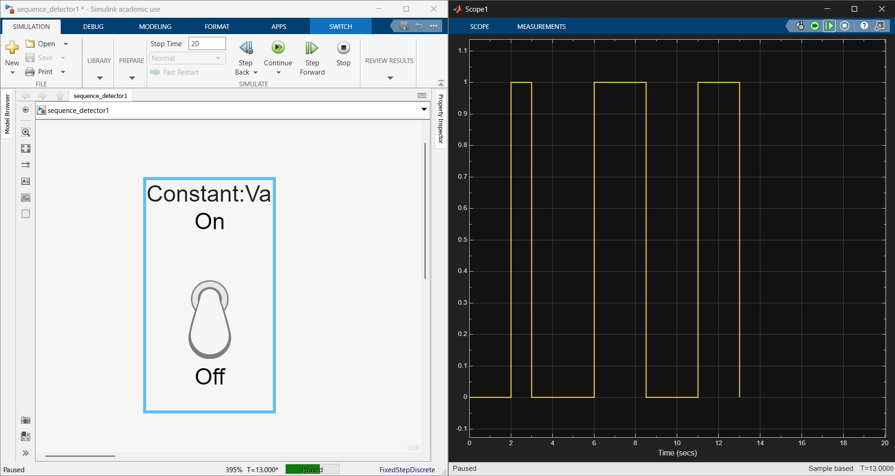

# Mealy 111 Sequence Detector (Simulink)

This project features the design, simulation, and behavioral testing of a Mealy-type `111` sequence detector using discrete logic gates and D Flip-Flops in MATLAB/Simulink.

## Circuit Schematic

Gate-level Simulink design: two D Flip-Flops with OR/AND next-state logic, an output AND gate, a clock source, constant `1` inputs on the !CLR pins, a dashboard toggle switch for the input, and scopes on the output.

[View the full schematic (PDF)](SystemSimulation.pdf)

## Simulation Walkthrough

Step-by-step testing with the dashboard toggle switch (left) and the output scope (right). Each screenshot is a paused point in the run, labeled by simulation time.

### 1. Input held high: output active (T = 8)

*Switch is On and the output sits at 1 after consecutive `1`s were detected.*

### 2. Input toggled off: output clears (T = 8.5)

*Switch is turned Off and the output drops back to 0.*

### 3. Input back on, two steps later (T = 10)

*Switch is On again, but after only two clocked steps the output is still 0.*

### 4. Input on, three steps later (T = 11)

*On the third consecutive `1`, the output rises to 1, confirming the `111` detection.*

### 5. Input toggled off again (T = 13)

*Switch is turned Off after the detection and the output returns to 0.*

## Troubleshooting & Key Takeaways

Through hands-on testing and debugging, I isolated and resolved several key digital logic and simulation setup challenges:

* Active-Low Hardware Initialization: Identified that floating active-low clear !CLR pins caused simulation startup errors. Tied both !CLR inputs to a boolean constant `1` to hold the flip-flops out of reset.
* Scope Trace Isolation: Separated overlapping single-axis scope traces into a 3-row stacked grid ( Y output, X input, CLK clock ) to clearly visualize state changes on rising clock edges.
* Clock-Aligned Manual Stepping: Adjusted Simulation Stepping Options so each step forward click aligned with rising clock edges, enabling step-by-step verification of state transitions (`00` → `01` → `11` → `10`).

## Practical Skills Applied

* FSM State Verification: Tested sequential logic responses to confirm output activation upon detecting three consecutive `1`s.
* Simulink Diagnostics: Leveraged the Diagnostic Viewer (`Ctrl+Shift+V`), boolean data-type matching, and parameter validation.
* Dashboard Controls: Linked interactive switches directly to block parameters for real-time input testing.

## Acknowledgments

* Self-Directed Work: Schematic design, logic gate wiring, manual step-through testing, scope layout configuration, and behavioral verification.
* AI Support (Gemini): Utilized as an interactive coach for error log interpretation and diagnostic troubleshooting tips.
